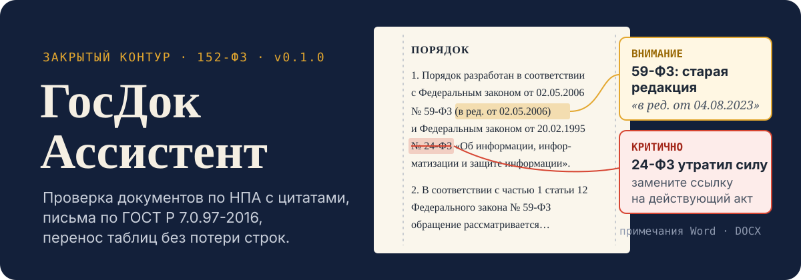
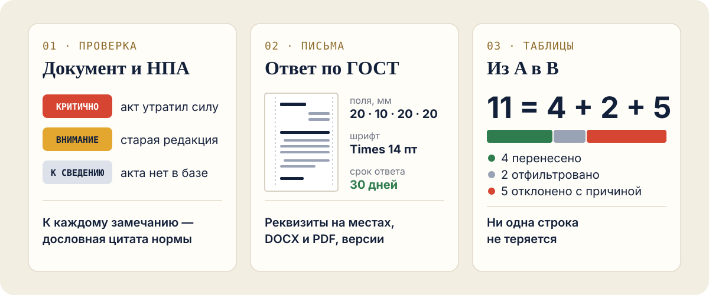
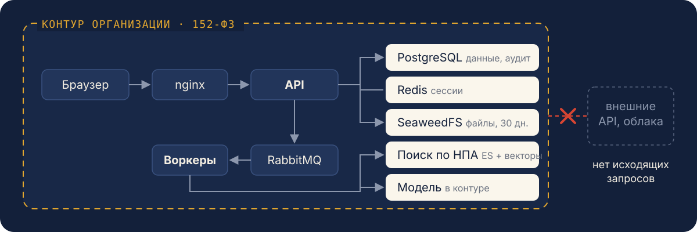

<p align="center">
  
</p>

<p align="center">
  <a href="https://github.com/Fgeeha/gosdoc-assistant/actions/workflows/ci.yml"></a>
  <a href="https://github.com/Fgeeha/gosdoc-assistant/releases/tag/v0.1.0"></a>
  
</p>

<p align="center">
  <a href="#быстрый-старт">Быстрый старт</a> ·
  <a href="docs/guides/user.md">Руководство пользователя</a> ·
  <a href="docs/guides/admin.md">Руководство администратора</a> ·
  <a href="docs/architecture.md">Архитектура</a>
</p>

**ГосДок Ассистент** берёт на себя рутину с документами в государственном
учреждении: сверяет документ с действующими нормативными актами, готовит
черновик служебного письма по ГОСТ и переносит данные между таблицами.
Модель, поиск и хранилище работают внутри организации — персональные данные
не покидают контур.

<p align="center">
  
</p>

## Что умеет

**Проверка документа.** Находит ссылки на НПА и сверяет их с нормативной
базой: акт утратил силу, устаревшая редакция (и изменился ли текст статьи),
неверная дата, нет такой статьи. Содержание сверяется с найденными нормами,
и замечание показывается **только вместе с дословной цитатой**, найденной в
тексте нормы. На выходе — ваш DOCX с примечаниями Word на полях. Принимает
DOCX, ODT, PDF, сканы (OCR), TXT.

**Письма.** Ответ на обращение гражданина, запрос, сопроводительное письмо.
Реквизиты расставляются по ГОСТ Р 7.0.97-2016, срок ответа по 59-ФЗ
считается с учётом выходных и праздников, проверяются стиль и маска
исходящего номера. Версии, DOCX, PDF, утверждение руководителем.

**Таблицы.** XLSX, XLS, CSV, ODS. Колонки сопоставляются по названиям — в
модель уходят только заголовки, без данных строк. Преобразования ФИО, дат,
сумм, справочников; ИНН, СНИЛС, ОГРН проверяются по контрольным суммам.
Каждая строка либо в результате, либо в отчёте с причиной.

> Всё, что подготовлено автоматически, — черновик. Решение и ответственность
> остаются за сотрудником.

## Как устроено

<p align="center">
  
</p>

Модульный монолит на FastAPI: общее ядро (вход, роли, аудит, файлы) и три
модуля. Долгие операции — OCR, индексация, PDF, перенос таблиц — выполняют
воркеры через очередь. Каждая организация видит только свои данные, файлы
удаляются через 30 дней. Модель подключается по OpenAI-совместимому API и
разворачивается в контуре. Подробно — [архитектура](docs/architecture.md) и
[решения (ADR)](docs/adr).

## Быстрый старт

Нужны Docker с Compose v2 и `make`.

```sh
git clone git@github.com:Fgeeha/gosdoc-assistant.git && cd gosdoc-assistant
make up-local        # при первом запуске создаст .env из .env.example
```

Откройте http://localhost:8080. Логин `admin`, пароль — `GOSDOC_ADMIN_PASSWORD`
из `.env`; при первом входе его нужно сменить.

Попробуйте на примерах из репозитория:

1. **Нормативная база** → загрузите акты из `tests/fixtures/npa`.
2. **Проверка** → загрузите `tests/fixtures/npa/checked-document.docx`:
   найдутся ссылка на утративший силу 24-ФЗ и на старую редакцию 59-ФЗ.
3. **Таблицы** → `tests/fixtures/tables/source.xlsx` и `template.xlsx`,
   «Предложить маппинг», затем «Перенести»: 11 строк = 4 + 2 + 5.

Локально вместо модели работает заглушка: письма получаются шаблоном с
пометками [уточнить], а проверка содержания не даёт замечаний. Для
осмысленного текста укажите адрес своей модели в `LLM_BASE_URL`.

## Документация

| Кому | Что читать |
|---|---|
| Сотруднику | [Руководство пользователя](docs/guides/user.md) |
| Администратору | [Руководство администратора](docs/guides/admin.md) — установка, роли, нормативная база, эксплуатация |
| Разработчику | [Архитектура](docs/architecture.md), [ADR](docs/adr), [правила разработки](CONTRIBUTING.md) |

## Разработка

```sh
make install         # зависимости (uv, npm)
make check           # ruff, mypy, tsc и все тесты
make test-unit       # быстрые тесты без Docker
make help            # все цели
```

Интеграционные тесты поднимают PostgreSQL и SeaweedFS через testcontainers;
выход во внешнюю сеть в тестах запрещён (`pytest-socket`). Каждый push и pull
request проверяет GitHub Actions: линтеры, тесты, Helm-чарт, сборка образов.
Сборка на Astra Linux / РЕД ОС, сканирование и выкатка — конвейер в контуре
`.gitflic-ci.yml`.

<details>
<summary><b>Структура репозитория</b></summary>

```
backend/gosdoc/   API и доменная логика: core — ядро; tables, letters, docs_check — модули
backend/alembic/  миграции БД
workers/          фоновые задачи dramatiq
rag/              нарезка НПА и гибридный поиск
frontend/         React + TypeScript + Ant Design
airflow/dags/     регламентные задачи
deploy/           Dockerfile, docker-compose.dev.yml, заглушка модели, Helm, мониторинг
docs/             архитектура, ADR, руководства
tests/            unit, integration, fixtures
```

</details>

<details>
<summary><b>Конфигурация</b></summary>

Все параметры — переменные окружения, полный список — в
`backend/gosdoc/core/config.py`. Основные:

| Переменная | Назначение |
|---|---|
| `DATABASE_URL`, `REDIS_URL`, `RABBITMQ_URL` | подключение к сервисам |
| `STORAGE_BACKEND` | `s3` (SeaweedFS и др.), `postgres` или `local` |
| `S3_ENDPOINT_URL`, `S3_ACCESS_KEY`, `S3_SECRET_KEY`, `S3_BUCKET` | S3-хранилище |
| `FILE_RETENTION_DAYS` | срок хранения загруженных файлов (30) |
| `LLM_BASE_URL`, `LLM_MODEL`, `LLM_API_KEY`, `LLM_MAX_CONTEXT` | модель (OpenAI-совместимый API) |
| `EMBEDDINGS_BASE_URL`, `EMBEDDINGS_MODEL` | эмбеддинги, если сервис отдельный |
| `AUTH_PROVIDER` | `local` или `ldap` |
| `CA_BUNDLE` | корневой сертификат для TLS к сервисам `*.fgau.local` |

</details>

<details>
<summary><b>Развёртывание в Kubernetes</b></summary>

1. Соберите и опубликуйте образы: `make images BASE_IMAGE=... IMAGE_PREFIX=<реестр>/gosdoc/gosdoc`.
2. Создайте Secret с ключами `DATABASE_URL`, `RABBITMQ_URL`, `S3_ACCESS_KEY`,
   `S3_SECRET_KEY`, `LLM_API_KEY`, `SERVICE_TOKEN` (32+ символов),
   `GOSDOC_ADMIN_PASSWORD` и ConfigMap с корневым CA.
3. `helm upgrade --install gosdoc deploy/helm/gosdoc -f values.yaml`
   (пример — `deploy/helm/gosdoc/values-example.yaml`).
4. Выложите `airflow/dags/*.py` в Airflow, задайте Variables
   `gosdoc_api_url`, `gosdoc_service_token`, `gosdoc_ca_bundle`
   (и `gosdoc_evidently_url`, `gosdoc_evidently_project`).
5. Логи — см. `deploy/monitoring/README.md`.

Подробно — в [руководстве администратора](docs/guides/admin.md).

</details>

## Ограничения версии 0.1.0

- Сборка образов на Astra Linux и РЕД ОС, интеграция с Milvus, MLFlow,
  Evidently и Loki на реальных сервисах ещё не проверены.
- Тексты НПА в `tests/fixtures/npa` — сокращённые выдержки для тестов; для
  работы загружайте официальные тексты.
