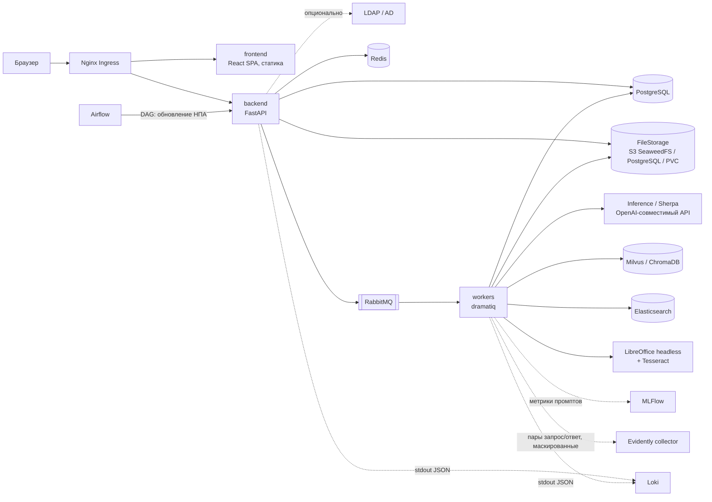
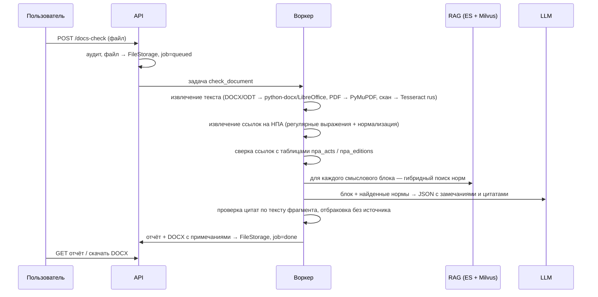
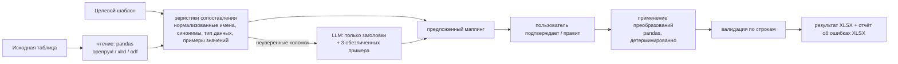
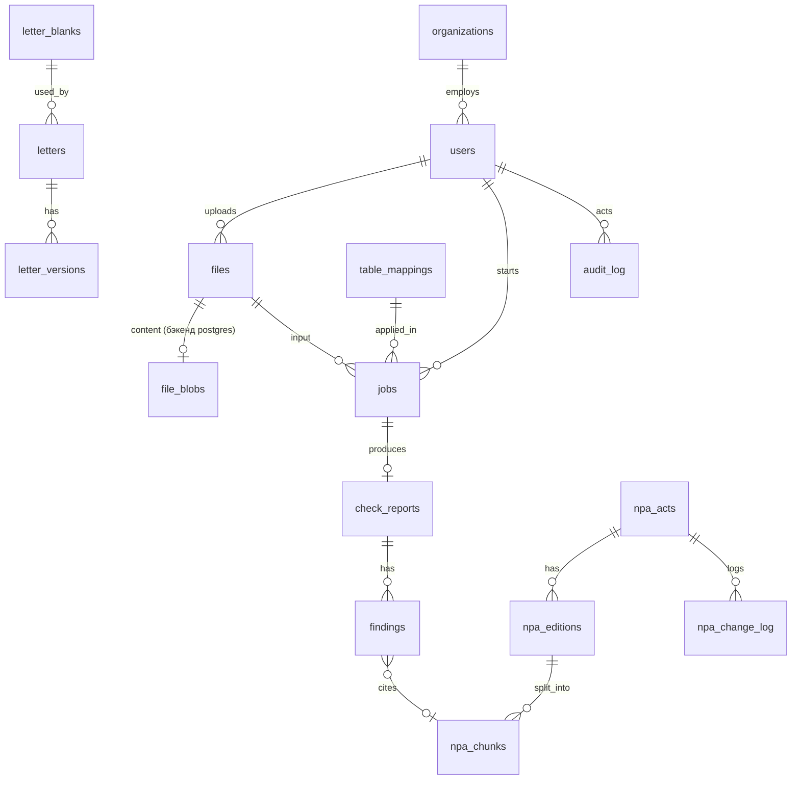
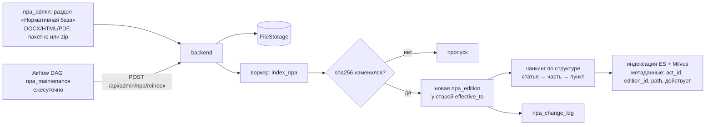

# Архитектура «ГосДок Ассистент»

Статус: **согласовано** (этап 1). Обоснования решений — в `docs/adr/`.

## 1. Принципы

1. **Закрытый контур.** Ни одного обращения к внешним адресам: LLM, эмбеддинги,
   OCR, шрифты, JS-библиотеки — всё локально. Проверяется тестом
   (`pytest-socket`, разрешены только адреса из конфигурации) и `NetworkPolicy`
   с запретом egress за пределы namespace.
2. **LLM советует, код решает.** Модель только предлагает: маппинг колонок,
   черновик письма, замечание с цитатой. Перенос данных, оформление по ГОСТ,
   проверка реквизитов НПА, контрольные суммы ИНН/СНИЛС/ОГРН — детерминированный
   код.
3. **Без источника — нет утверждения.** Замечание RAG-проверки сохраняется только
   если в нём есть цитата, дословно найденная в фрагменте нормы из выдачи
   поиска (проверка подстрокой после нормализации пробелов). Иначе замечание
   отбрасывается и пишется в метрики как «неподтверждённое».
4. **Всё, что выдала модель, — черновик.** Флаг `is_draft=true` у каждой сущности,
   созданной с участием LLM; в UI — плашка, в DOCX — колонтитул
   «ЧЕРНОВИК. Сформировано автоматически, требует проверки». Снять флаг может
   только человек, это действие попадает в аудит.
5. **Модульный монолит.** Один backend-сервис с тремя доменными модулями и общим
   ядром, плюс воркеры из того же кода. Микросервисы не нужны: одна команда,
   общая БД, нагрузка — десятки-сотни пользователей (ADR-0001).
6. **Мультиарендность с первого дня.** `organization_id` во всех доменных
   таблицах, фильтрация в репозиториях. Сейчас организация одна (ADR-0006).
7. **Только адреса из конфигурации.** Все внешние сервисы заказываются на
   платформе ФГАУ «ЦИТ» и подключаются по адресу/паролю из конфигурации;
   TLS проверяется локальным корневым CA (`CA_BUNDLE`).

## 2. Компоненты



| Компонент | Роль | Dev (docker-compose) | Prod (Kubernetes) |
|---|---|---|---|
| `backend` | REST API, авторизация, аудит, постановка задач | да | Deployment + HPA |
| `workers` | OCR, проверка документов, генерация писем, пакетные таблицы, индексация НПА | да | Deployment, отдельные очереди |
| `frontend` | SPA, отдаётся Nginx | Vite dev server | Deployment (nginx + статика) |
| PostgreSQL | основная БД, сессии нет — они в Redis | да | услуга платформы |
| Redis | сессии, кэш, rate-limit | да | да |
| RabbitMQ | брокер задач | да | да |
| FileStorage | файлы | SeaweedFS (`server -s3`) | SeaweedFS S3 / PostgreSQL / PVC — по конфигу |
| Векторный поиск | фрагменты НПА | ChromaDB | MilvusCluster |
| Elasticsearch | полнотекст по НПА | да (single-node) | да |
| LDAP/AD | вход (опционально) | — (mock в тестах) | по конфигу |
| LLM | генерация | mock-сервер или локальная модель | Inference / Sherpa |
| Airflow | регламент | нет (задачи запускаются CLI) | услуга платформы, DAG из `airflow/dags` |
| MLFlow, Evidently, Loki | наблюдаемость | нет (опциональный профиль) | да |

Langflow и Jupyter Lab используются только для прототипов и в
репозиторий/деплой не входят.

## 3. Структура кода

```
backend/gosdoc/
├── core/          # config, db, auth (local/ldap, сессии), audit, logging (маскирование ПДн), storage, llm, health
├── docs_check/    # модуль 1 (этап 5): api, service, npa_refs (извлечение ссылок), report, docx_review
├── letters/       # модуль 2 (этап 4): api, service, gost (реквизиты, оформление), deadlines, style_check
├── tables/        # модуль 3 (этап 3): api, service, mapping (эвристики + LLM), transforms, validators
├── api/           # роутеры ядра: auth, admin, files
├── cli.py         # служебные команды: wait-deps, init-storage, create-user, cleanup-files
└── main.py
workers/           # dramatiq-акторы, импортируют gosdoc.*; образ тот же, что у API
rag/               # chunker (статья/часть/пункт), indexer, retriever (гибрид + RRF), prompts/*.yaml
airflow/dags/      # npa_update.py — тонкий DAG, вызывает API backend
```

Абстракции заводятся только там, где реализаций действительно несколько:
`FileStorage` (s3 / postgres / local), `AuthProvider` (local / ldap),
`VectorStore` (Chroma / Milvus). LLM-заглушка — отдельный HTTP-сервис
`deploy/mock-llm`, клиент один.

## 4. Потоки данных

### 4.1 Модуль 1. Проверка документа



**Проверка ссылок** — без LLM. Ссылка нормализуется в ключ
`(вид, номер, дата принятия)`, например `(ФЗ, 59-ФЗ, 2006-05-02)`. Результаты:

| Статус | Условие | Критичность |
|---|---|---|
| `not_found` | акта нет в базе | предупреждение |
| `repealed` | у акта `repealed_at` ≤ даты проверки | критично |
| `outdated_edition` | ссылка указывает редакцию/дату, после которой есть новые редакции | существенно |
| `ok` | актуально | — |

**Смысловая проверка.** Документ режется на блоки (абзацы → окна ~1500
символов). Поиск: BM25 в Elasticsearch и векторный в Milvus, объединение через
Reciprocal Rank Fusion, top-k подбирается под `LLM_MAX_CONTEXT`, фильтр — только действующие редакции. Промпт
требует ответ строго в JSON: `{severity, doc_fragment, npa_chunk_id, quote,
recommendation}`. Цитата проверяется программно (принцип 3).

**DOCX с рецензированием.** Примечания — нативные комментарии Word
(`python-docx` ≥ 1.2). Правки в режиме рецензирования (`w:ins`/`w:del`)
python-docx не поддерживает. В MVP — только примечания, предлагаемая правка
пишется текстом в примечании.

### 4.2 Модуль 2. Письма

1. Вход: входящее письмо (файл, текст извлекается как в 4.1) и/или описание
   задачи, тип письма, выбранный бланк.
2. LLM получает тип письма, описание, извлечённый текст входящего и шаблон
   структуры (из `rag/prompts/letters/<тип>.yaml`) → возвращает **только
   смысловые блоки** (обращение, основной текст, заключение) в JSON.
3. Реквизиты (бланк, дата, исх. номер, ссылка на входящий, адресат, подпись,
   отметка об исполнителе) подставляются кодом. Исходящий номер вводится
вручную и проверяется по маске из настроек организации. Всё через `docxtpl` в DOCX-шаблон
   бланка по ГОСТ Р 7.0.97-2016 (поля, шрифт, расположение реквизитов
   проверяются тестом по XML документа). Модель реквизиты не формирует.
4. Проверки: срок ответа (59-ФЗ — 30 дней с регистрации, продление ещё на 30;
   праздники — по таблице производственного календаря, её ведёт администратор), ссылки на НПА в тексте —
   через модуль 1 (синхронно, только проверка ссылок), стиль — словарь
   разговорных/недопустимых оборотов + длина предложений.
5. Редактирование в UI → каждое сохранение = новая `letter_versions`. PDF — через
   LibreOffice headless в воркере.

MVP: ответ на обращение гражданина, запрос, сопроводительное письмо.

### 4.3 Модуль 3. Перенос данных между таблицами



- **В LLM не уходят данные строк.** Только названия колонок и до трёх примеров
  значений после маскирования ПДн (`Иванов И.И.` → `Фамилия И.О.`,
  СНИЛС → `XXX-XXX-XXX XX`).
- Маппинг хранится как декларативная JSON-спецификация, без кода:

```json
{
  "columns": [
    {"target": "ФИО", "op": "concat", "sources": ["Фамилия", "Имя", "Отчество"], "sep": " "},
    {"target": "Дата рождения", "op": "date", "source": "ДР", "in_format": "auto", "out_format": "%d.%m.%Y"},
    {"target": "Сумма", "op": "money", "source": "Сумма, руб."},
    {"target": "Пол", "op": "dict", "source": "Пол", "map": {"м": "Мужской", "ж": "Женский"}}
  ],
  "filter": [{"column": "Статус", "op": "eq", "value": "активен"}],
  "group_by": null,
  "validate": {"ИНН": ["required", "inn"], "СНИЛС": ["snils"]}
}
```

- Операции MVP: `copy`, `concat`, `split`, `date`, `fio_split`/`fio_join`,
  `money`, `dict`, `const`; фильтрация; агрегация (`group_by` + sum/count/first).
- **Без потерь:** каждая строка источника либо попадает в результат, либо
  попадает в отчёт с причиной (отфильтрована правилом / ошибка валидации).
  Инвариант `rows_in = rows_out + rows_filtered + rows_rejected` проверяется
  в коде и в тестах.
- Пакетная обработка: N файлов × один сохранённый маппинг → задача на файл.

## 5. Модель данных (PostgreSQL)

Все доменные таблицы содержат `organization_id` (ADR-0006). НПА бывают общими
(`organization_id IS NULL`) и ведомственными.



| Таблица | Ключевые поля | Этап |
|---|---|---|
| `organizations` | id, name, short_name, settings jsonb (маска исх. номера и пр.) | 2 |
| `users` | id, organization_id, login, full_name, department, roles text[], password_hash (argon2, null для LDAP), auth_source, failed_attempts, locked_until, is_active, must_change_password, last_login_at | 2 |
| `files` | id, organization_id, owner_id, storage_key, original_name, mime, size, sha256, contains_pdn, created_at, expires_at | 2 |
| `file_blobs` | storage_key, data bytea — только для бэкенда `postgres` | 2 |
| `audit_log` | id, at, organization_id, user_id, ip, action, object_type, object_id, details jsonb (ПДн замаскированы) | 2 |
| `jobs` | id, organization_id, kind (`docs_check`/`letter`/`table`/`npa_index`), status, input_file_id, params jsonb, result jsonb, error, created_by, timestamps | 3 |
| `table_mappings` | id, organization_id, name, spec jsonb, target_template_file_id, owner_id, shared | 3 |
| `letter_blanks` | id, organization_id, name, template_file_id, fields jsonb, uploaded_by, active | 4 |
| `letters` | id, organization_id, type, blank_id, incoming_file_id, outgoing_number, date, addressee, executor, deadline, status, is_draft | 4 |
| `letter_versions` | id, letter_id, version, body jsonb, author_id (null = LLM), docx_file_id, pdf_file_id, created_at | 4 |
| `holidays` | date, organization_id (null = общий), is_workday | 4 |
| `npa_acts` | id, organization_id (null = общий), kind, number, adopted_at, title, issuer, repealed_at, canonical_key | 5 |
| `npa_editions` | id, act_id, effective_from, effective_to, source_file_id, text_sha256 | 5 |
| `npa_chunks` | id, edition_id, path (`ст. 12 ч. 1 п. 3`), text, vector_id | 5 |
| `npa_change_log` | id, act_id, change (`new_edition`/`repealed`/`added`), details jsonb, at | 5 |
| `check_reports` | id, organization_id, job_id, summary jsonb, result_docx_file_id, is_draft | 5 |
| `findings` | id, report_id, kind (`npa_ref`/`content`), severity, doc_fragment, npa_chunk_id, quote, recommendation, user_verdict | 5 |

Таблицы создаются миграциями Alembic на том этапе, где появляется модуль.

`audit_log` — только INSERT: триггер запрещает UPDATE/DELETE; в проде у роли
приложения дополнительно отзываются эти права. Партиционирование по месяцам —
когда объём этого потребует.

Версии промптов и моделей хранятся в MLFlow; в `jobs.result` пишутся
`prompt_version` и `model_name` для воспроизводимости.

## 6. Безопасность и 152-ФЗ

- **Аутентификация (ADR-0005):** учётные записи в PostgreSQL, пароль — argon2,
  сессия — случайный токен в Redis, в браузере httpOnly cookie (SameSite=Strict).
  Блокировка после `AUTH_MAX_FAILED_ATTEMPTS` неудачных попыток на
  `AUTH_LOCKOUT_MINUTES`. Пользователей создаёт администратор, при первом входе
  пароль меняется. Слой `AuthProvider`: `local` (сейчас) и `ldap` (ldap3,
  роли — по группам AD из конфигурации), переключается `AUTH_PROVIDER`.
- **Роли** (проверка в зависимостях FastAPI):

| Роль | Права |
|---|---|
| `user` | свои файлы, проверки, письма, таблицы; общие шаблоны маппинга — чтение |
| `manager` | + просмотр работ своего подразделения, снятие флага «черновик» с писем |
| `npa_admin` | загрузка и редактирование нормативной базы, запуск переиндексации |
| `sys_admin` | пользователи, бланки писем, настройки организации, журнал аудита |

- **Маскирование ПДн в логах:** форматтер `JsonFormatter` на корневом логгере (сообщение маскируется уже после подстановки аргументов), регулярные
  выражения для СНИЛС, ИНН, паспорта, телефонов, e-mail, номеров карт.
  Тексты документов и промпты в логи не пишутся вообще — только id и длины.
  В Evidently и MLFlow уходят те же маскированные данные.
- **Хранение файлов (ADR-0004):** все пользовательские загрузки считаются
  содержащими ПДн и получают `expires_at = now + FILE_RETENTION_DAYS` (30 по
  умолчанию). Удаление — фоновая задача по метаданным в PostgreSQL, не
  lifecycle-правила хранилища. Файлы нормативной базы срока не имеют.
- **Аудит:** вход/выход/неудачный вход, загрузка, скачивание, запуск задачи,
  генерация, правка, снятие черновика, изменение настроек и пользователей,
  автоудаление файлов.
- **ML-безопасность:** образ и пайплайны прогоняются через Сканер безопасности ML
  в CI (стадия `scan`).

## 7. Нормативная база: актуализация



Старые редакции не удаляются: они хранятся с `effective_to` и по умолчанию
исключаются из поиска фильтром. Это позволяет проверять «на дату документа».
DAG также чистит индексы от удалённых актов и запускает очистку файлов с
истёкшим сроком хранения.

## 8. Инфраструктура и CI/CD

- **Платформа:** облако ФГАУ «ЦИТ». PostgreSQL, Redis, Elasticsearch, RabbitMQ,
  Kubernetes, Inference, Airflow, MLFlow, Milvus заказываются через портал и
  подключаются по адресам `*.fgau.local` и паролям из Secret. TLS — через
  локальный корневой CA (`CA_BUNDLE`), он используется для PostgreSQL, S3,
  Inference и LDAP.
- **Образы (ADR-0007):** базовый образ — аргумент сборки `BASE_IMAGE`:
  `registry.astralinux.ru/astra/ubi18` (по умолчанию) или
  `registry.red-soft.ru/ubi8/ubi`. Python, Tesseract (rus), LibreOffice, Node.js
  (стадия сборки фронтенда) и nginx ставятся пакетами ОС. Один Dockerfile,
  targets: `api`, `worker` (+ LibreOffice, Tesseract), `frontend` (nginx +
  статика). `python:3.11-slim` — только в `docker-compose.dev.yml`.
- **Helm (ADR-0009, этап 6):** чарт разворачивает только приложение: api,
  воркеры, frontend/nginx, Job миграций Alembic. Внешние сервисы — адреса и
  секреты в values/Secret, CA-бандл монтируется из Secret/ConfigMap.
  readiness/liveness, initContainer ждёт доступности зависимостей
  (`gosdoc wait-deps`). DAG выкладываются в заказанный Airflow отдельно.
  SeaweedFS в чарт не входит.
- **`.gitflic-ci.yml`:** `lint` (ruff, mypy, tsc) → `test` (pytest unit +
  интеграционные на testcontainers) → `build` (образы) → `scan` (сканер образов
  + Сканер безопасности ML) → `deploy` (helm upgrade, ручной запуск; этап 6).
- **Наблюдаемость:** логи JSON в stdout → Loki; Evidently — качество ответов
  (доля замечаний, отброшенных из-за отсутствия источника; доля замечаний,
  отклонённых пользователем; длины ответов; дрейф эмбеддингов запросов);
  MLFlow — промпты, версии моделей, офлайн-оценки на эталонном наборе.

## 9. Локальная разработка

`make up-local` поднимает PostgreSQL, Redis, RabbitMQ, Elasticsearch, ChromaDB,
SeaweedFS (`server -s3`), mock-LLM, api, worker и frontend; миграции и
создание администратора выполняются автоматически. Реальная модель
подключается переменными `LLM_BASE_URL` / `EMBEDDINGS_BASE_URL`. Для тестов
не нужны ни GPU, ни модель.

## 10. Решения

См. `docs/adr/` — по одному файлу на решение.
