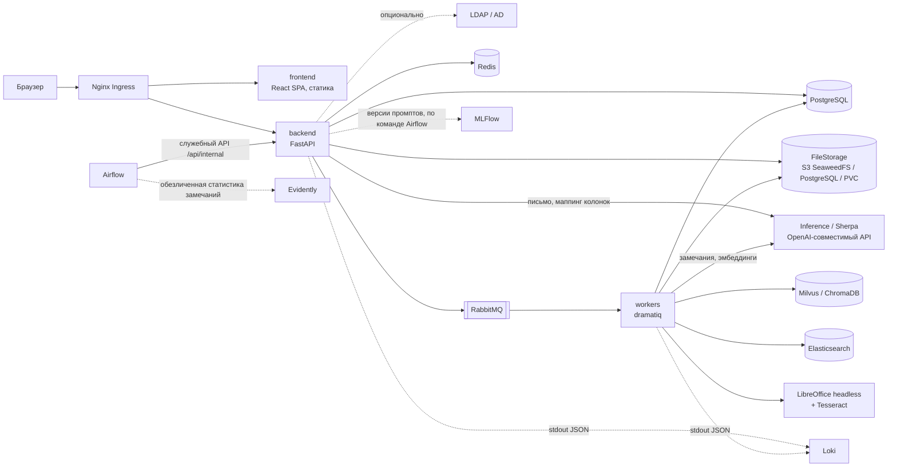
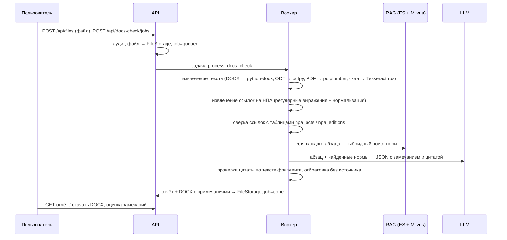
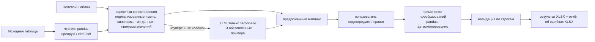
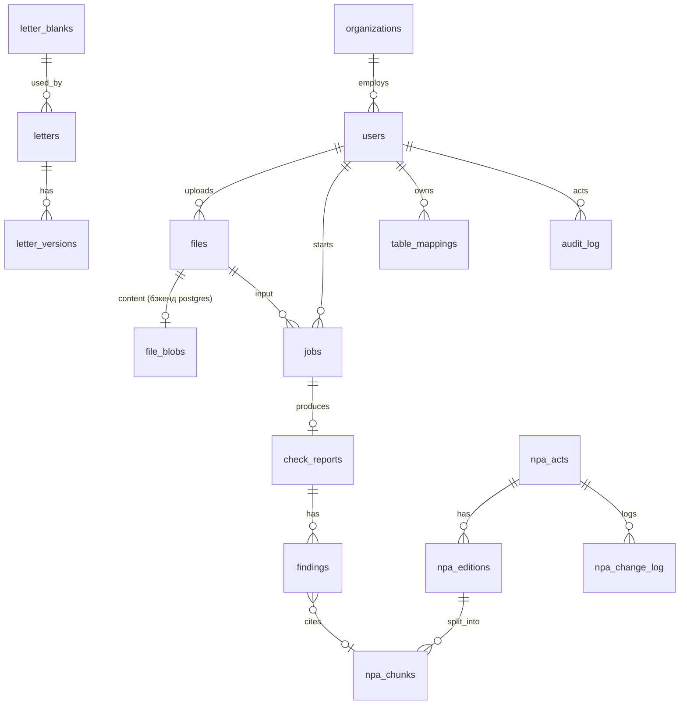
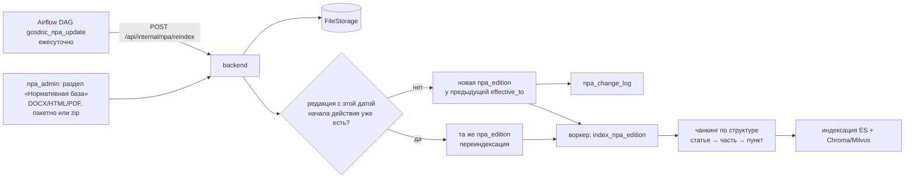

# Архитектура «ГосДок Ассистент»

Статус: **согласовано** (этап 1). Обоснования решений — в `docs/adr/`.

## 1. Принципы

1. **Закрытый контур.** Ни одного обращения к внешним адресам: LLM, эмбеддинги,
   OCR, шрифты, JS-библиотеки — всё локально. Проверяется тестом
   (`pytest-socket`, разрешены только адреса из конфигурации) и `NetworkPolicy`
   с запретом egress за пределы namespace.
2. **LLM советует, код решает.** Модель только предлагает: маппинг колонок,
   черновик письма, замечание с цитатой. Перенос данных, оформление по ГОСТ,
   проверка реквизитов НПА, контрольные суммы ИНН/СНИЛС/ОГРН — детерминированный
   код.
3. **Без источника — нет утверждения.** Замечание RAG-проверки сохраняется только
   если в нём есть цитата, дословно найденная в фрагменте нормы из выдачи
   поиска (проверка подстрокой после нормализации пробелов). Иначе замечание
   отбрасывается и пишется в метрики как «неподтверждённое».
4. **Всё, что выдала модель, — черновик.** Флаг `is_draft=true` у писем и
   отчётов проверки; в UI — плашка «Черновик» (письма, проверка, предложенный
   маппинг таблиц). В DOCX проверки автор примечаний — «ГосДок (черновик)», а
   отчёт начинается с предупреждения о черновике. Флаг с письма снимает только
   руководитель (роль `manager`), это действие попадает в аудит.
5. **Модульный монолит.** Один backend-сервис с тремя доменными модулями и общим
   ядром, плюс воркеры из того же кода. Микросервисы не нужны: одна команда,
   общая БД, нагрузка — десятки-сотни пользователей (ADR-0001).
6. **Мультиарендность с первого дня.** `organization_id` во всех доменных
   таблицах, фильтрация в репозиториях. Сейчас организация одна (ADR-0006).
7. **Только адреса из конфигурации.** Все внешние сервисы заказываются на
   платформе ФГАУ «ЦИТ» и подключаются по адресу/паролю из конфигурации;
   TLS проверяется локальным корневым CA (`CA_BUNDLE`).

## 2. Компоненты



| Компонент | Роль | Dev (docker-compose) | Prod (Kubernetes) |
|---|---|---|---|
| `backend` | REST API, авторизация, аудит, черновик письма и подсказка маппинга (с вызовом модели), постановка задач | да | Deployment |
| `workers` | OCR, проверка документов, PDF писем, пакетные таблицы, индексация НПА, очистка файлов | да | Deployment, группы очередей |
| `frontend` | SPA, отдаётся Nginx | nginx + статика (Vite dev server — `make run-frontend`) | Deployment (nginx + статика) |
| PostgreSQL | основная БД, сессии нет — они в Redis | да | услуга платформы |
| Redis | сессии | да | да |
| RabbitMQ | брокер задач | да | да |
| FileStorage | файлы | SeaweedFS (`server -s3`) | SeaweedFS S3 / PostgreSQL / PVC — по конфигу |
| Векторный поиск | фрагменты НПА | ChromaDB | MilvusCluster |
| Elasticsearch | полнотекст по НПА | да (single-node) | да |
| LDAP/AD | вход (опционально) | — (mock в тестах) | по конфигу |
| LLM | генерация | mock-сервер или локальная модель | Inference / Sherpa |
| Airflow | регламент | нет (очистку файлов выполняет контейнер `scheduler`) | услуга платформы, DAG из `airflow/dags` |
| MLFlow, Evidently, Loki | наблюдаемость | нет (опциональный профиль) | да |

Langflow и Jupyter Lab используются только для прототипов и в
репозиторий/деплой не входят.

## 3. Структура кода

```
backend/gosdoc/
├── core/          # config, db, repository, auth (local/ldap, сессии), audit, logging (маскирование ПДн),
│                  # storage, files, text (извлечение текста, OCR), llm, queue, mlflow, health
├── docs_check/    # модуль 1 (этап 5): api, service, checker (ссылки + содержание), npa (база и индексация),
│                  # npa_refs (извлечение ссылок), docx_review, prompts.yaml
├── letters/       # модуль 2 (этап 4): api, service, gost (реквизиты, оформление), deadlines, style_check, prompts/*.yaml
├── tables/        # модуль 3 (этап 3): api, service, mapping (эвристики + LLM), spec, tableio, transforms, validators
├── api/           # роутеры ядра: auth, admin, files, internal (служебный API для Airflow); deps — пользователь и роли
├── cli.py         # служебные команды: wait-deps, wait-migrations, init-storage, create-user, cleanup-files
└── main.py
workers/           # dramatiq-акторы, импортируют gosdoc.*; образ воркера = образ API + LibreOffice и Tesseract
rag/               # chunker (статья/часть/пункт), search (индексы Elasticsearch / Chroma / Milvus, RRF)
airflow/dags/      # gosdoc_npa_update, gosdoc_maintenance, gosdoc_quality — тонкие DAG, вызывают служебный API
```

Абстракции заводятся только там, где реализаций действительно несколько:
`FileStorage` (s3 / postgres / local), `AuthProvider` (local / ldap),
`VectorIndex` (Chroma / Milvus). LLM-заглушка — отдельный HTTP-сервис
`deploy/mock-llm`, клиент один.

## 4. Потоки данных

### 4.1 Модуль 1. Проверка документа



**Проверка ссылок** — без LLM. Ссылка нормализуется в ключ
`(вид, номер, дата принятия)`, например `(ФЗ, 59-ФЗ, 2006-05-02)`. Результаты
(`findings.kind = npa_ref`):

| Замечание | Условие | `severity` |
|---|---|---|
| акт не найден | акта нет в базе | `info` |
| акт утратил силу | у акта `repealed_at` ≤ даты проверки | `critical` |
| неверная дата акта | дата в ссылке не совпадает с датой принятия в базе | `warning` |
| устаревшая редакция | ссылка указывает редакцию, после которой есть действующая; для статьи — только если её текст изменился | `warning` |
| нет такой статьи | указанной статьи/части нет в действующей редакции | `warning` |

**Смысловая проверка.** Проверяются абзацы не короче 80 символов, не более 30
на документ. Поиск: BM25 в Elasticsearch и векторный в Chroma/Milvus,
объединение через Reciprocal Rank Fusion, в выдаче 5 фрагментов; из них
остаются только действующие редакции неотменённых актов, под нормы отводится
половина `LLM_MAX_CONTEXT`. Промпт требует ответ строго в JSON: `{verdict,
source, quote, explanation, recommendation}`, где `source` — номер нормы из
переданного списка. Цитата проверяется программно (принцип 3).

**DOCX с рецензированием.** Примечания — нативные комментарии Word
(`python-docx` ≥ 1.2). Правки в режиме рецензирования (`w:ins`/`w:del`)
python-docx не поддерживает. В MVP — только примечания, предлагаемая правка
пишется текстом в примечании.

### 4.2 Модуль 2. Письма

1. Вход: входящее письмо (файл, текст извлекается как в 4.1) и/или описание
   задачи, тип письма, выбранный бланк.
2. LLM получает тип письма, описание, извлечённый текст входящего и шаблон
   структуры (из `backend/gosdoc/letters/prompts/<тип>.yaml` — промпты входят в образ) → возвращает **только
   смысловые блоки** (обращение, основной текст, заключение) в JSON.
3. Реквизиты (бланк, дата, исх. номер, ссылка на входящий, адресат, подпись,
   отметка об исполнителе) подставляются кодом. Исходящий номер вводится
вручную и проверяется по маске из настроек организации. Всё через `docxtpl` в DOCX-шаблон
   бланка по ГОСТ Р 7.0.97-2016 (поля, шрифт, расположение реквизитов
   проверяются тестом по XML документа). Модель реквизиты не формирует.
4. Проверки: срок ответа (59-ФЗ — 30 дней с регистрации, продление ещё на 30;
   праздники — по таблице производственного календаря, её ведёт администратор), стиль — словарь
   разговорных/недопустимых оборотов + длина предложений. Ссылки на НПА в
   тексте письма не проверяются: модули независимы, письмо можно отдельно
   загрузить в раздел «Проверка».
5. Редактирование в UI → каждое сохранение = новая `letter_versions`. PDF — через
   LibreOffice headless в воркере.

Черновик и DOCX формируются синхронно в `api` (модель вызывается в рамках
запроса), через очередь идёт только PDF.

MVP: ответ на обращение гражданина, запрос, сопроводительное письмо.

### 4.3 Модуль 3. Перенос данных между таблицами



- **В LLM не уходят данные строк.** Только названия колонок и до трёх примеров
  значений после маскирования ПДн (`Иванов И.И.` → `Фамилия И.О.`,
  СНИЛС → `XXX-XXX-XXX XX`).
- Маппинг хранится как декларативная JSON-спецификация, без кода:

```json
{
  "columns": [
    {"target": "ФИО", "op": "concat", "sources": ["Фамилия", "Имя", "Отчество"], "sep": " "},
    {"target": "Дата рождения", "op": "date", "source": "ДР", "in_format": "auto", "out_format": "%d.%m.%Y"},
    {"target": "Сумма", "op": "money", "source": "Сумма, руб."},
    {"target": "Пол", "op": "dict", "source": "Пол", "map": {"м": "Мужской", "ж": "Женский"}}
  ],
  "filter": [{"column": "Статус", "op": "eq", "value": "активен"}],
  "group_by": null,
  "validate": {"ИНН": ["required", "inn"], "СНИЛС": ["snils"]}
}
```

- Операции MVP: `copy`, `concat`, `split`, `date`, `fio_split`/`fio_join`,
  `money`, `dict`, `const`; фильтрация; агрегация (`group_by` + sum/count/first).
- **Без потерь:** каждая строка источника либо попадает в результат, либо
  попадает в отчёт с причиной (отфильтрована правилом / ошибка валидации).
  Инвариант `rows_in = rows_out + rows_filtered + rows_rejected` проверяется
  в коде и в тестах.
- Пакетная обработка: N файлов × один сохранённый маппинг → задача на файл.

## 5. Модель данных (PostgreSQL)

Все доменные таблицы содержат `organization_id` (ADR-0006). НПА бывают общими
(`organization_id IS NULL`) и ведомственными.



| Таблица | Ключевые поля | Этап |
|---|---|---|
| `organizations` | id, name, short_name, settings jsonb (маска исх. номера и пр.) | 2 |
| `users` | id, organization_id, login, full_name, department, roles text[], password_hash (argon2, null для LDAP), auth_source, failed_attempts, locked_until, is_active, must_change_password, last_login_at | 2 |
| `files` | id, organization_id, owner_id, storage_key, original_name, mime, size, sha256, contains_pdn, created_at, expires_at | 2 |
| `file_blobs` | storage_key, data bytea — только для бэкенда `postgres` | 2 |
| `audit_log` | id, at, organization_id, user_id, ip, action, object_type, object_id, details jsonb (ПДн замаскированы) | 2 |
| `jobs` | id, organization_id, kind (`docs_check`/`letter_pdf`/`table`), status, input_file_id, params jsonb, result jsonb, error, created_by, timestamps | 3 |
| `table_mappings` | id, organization_id, name, spec jsonb, target_template_file_id, owner_id, shared, timestamps | 3 |
| `letter_blanks` | id, organization_id, name, template_file_id, fields jsonb, uploaded_by, active | 4 |
| `letters` | id, organization_id, type, blank_id, incoming_file_id, outgoing_number, date, addressee, executor, deadline, status (`draft`/`approved`), is_draft, requisites jsonb, created_by, created_at | 4 |
| `letter_versions` | id, letter_id, version, body jsonb, author_id (null = LLM), docx_file_id, pdf_file_id, meta jsonb (`prompt_version`, `model_name`), created_at | 4 |
| `holidays` | date, is_workday, note — только отклонения от календаря по умолчанию (сб, вс, ст. 112 ТК РФ); календарь федеральный, общий | 4 |
| `npa_acts` | id, organization_id (null = общий), kind, number, adopted_at, title, issuer, repealed_at, repealed_note, canonical_key | 5 |
| `npa_editions` | id, act_id, effective_from, effective_to, source_file_id, text_sha256, status (состояние индексации), error, indexed_at | 5 |
| `npa_chunks` | id, edition_id, path (`ст. 12 ч. 1 п. 3`), article, heading, text; id фрагмента служит ключом в обоих индексах | 5 |
| `npa_change_log` | id, act_id, change (`added`/`new_edition`/`repealed`/`restored`/`reindexed`), details jsonb, user_id, at | 5 |
| `check_reports` | id, organization_id, job_id, summary jsonb, result_docx_file_id, report_docx_file_id, is_draft, created_at | 5 |
| `findings` | id, report_id, kind (`npa_ref`/`content`), severity, doc_fragment, npa_ref, npa_chunk_id, norm, quote, message, recommendation, user_verdict | 5 |

Таблицы создаются миграциями Alembic на том этапе, где появляется модуль.

`audit_log` — только INSERT: триггер запрещает UPDATE/DELETE; в проде у роли
приложения дополнительно отзываются эти права. Партиционирование по месяцам —
когда объём этого потребует.

Индексация НПА — не запись в `jobs`: её состояние хранится в
`npa_editions.status`.

Версии промптов и моделей хранятся в MLFlow; для воспроизводимости
`prompt_version` и `model_name` пишутся в `check_reports.summary` и
`letter_versions.meta`.

## 6. Безопасность и 152-ФЗ

- **Аутентификация (ADR-0005):** учётные записи в PostgreSQL, пароль — argon2,
  сессия — случайный токен в Redis, в браузере httpOnly cookie (SameSite=Strict).
  Блокировка после `AUTH_MAX_FAILED_ATTEMPTS` неудачных попыток на
  `AUTH_LOCKOUT_MINUTES`. Пользователей создаёт администратор, при первом входе
  пароль меняется. Слой `AuthProvider`: `local` (сейчас) и `ldap` (ldap3,
  роли — по группам AD из конфигурации), переключается `AUTH_PROVIDER`.
- **Роли** (проверка в зависимостях FastAPI):

| Роль | Права |
|---|---|
| `user` | свои файлы, проверки, письма, таблицы; общие шаблоны маппинга — чтение |
| `manager` | + просмотр работ своего подразделения, снятие флага «черновик» с писем |
| `npa_admin` | загрузка и редактирование нормативной базы, запуск переиндексации |
| `sys_admin` | пользователи, бланки писем, настройки организации, журнал аудита |

- **Маскирование ПДн в логах:** форматтер `JsonFormatter` на корневом логгере (сообщение маскируется уже после подстановки аргументов), регулярные
  выражения для СНИЛС, ИНН, паспорта, телефонов, e-mail, номеров карт.
  Тексты документов и промпты в логи не пишутся вообще — только id и длины.
  В Evidently уходят только обезличенные признаки замечаний (вид, критичность,
  оценка сотрудника, версия промпта) без текстов и цитат; в MLFlow — тексты
  промптов, без данных документов.
- **Хранение файлов (ADR-0004):** все пользовательские загрузки считаются
  содержащими ПДн и получают `expires_at = now + FILE_RETENTION_DAYS` (30 по
  умолчанию). Удаление — фоновая задача по метаданным в PostgreSQL, не
  lifecycle-правила хранилища. Файлы нормативной базы срока не имеют.
- **Аудит:** вход/выход/неудачный вход, загрузка, скачивание, запуск задачи,
  генерация, правка, снятие черновика, изменение настроек и пользователей,
  автоудаление файлов.
- **ML-безопасность:** образ и пайплайны прогоняются через Сканер безопасности ML
  в CI (стадия `scan`).

## 7. Нормативная база: актуализация



Редакция определяется датой начала действия: повторная загрузка с той же
датой заменяет файл и переиндексирует редакцию, с новой — создаёт новую
редакцию, а границы действия соседних пересчитываются. Хеш текста
(`text_sha256`) сохраняется, но загрузку не пропускает.

Старые редакции не удаляются: они хранятся с `effective_to` и при смысловой
проверке отсеиваются (остаются только действующие сегодня). Это позволяет
сравнивать текст статьи в редакции, на которую ссылается документ, с
действующей. DAG `gosdoc_npa_update` повторяет незавершённые индексации, а по
воскресеньям переиндексирует всю базу; очистка файлов с истёкшим сроком
хранения — отдельный DAG `gosdoc_maintenance`.

## 8. Инфраструктура и CI/CD

- **Платформа:** облако ФГАУ «ЦИТ». PostgreSQL, Redis, Elasticsearch, RabbitMQ,
  Kubernetes, Inference, Airflow, MLFlow, Milvus заказываются через портал и
  подключаются по адресам `*.fgau.local` и паролям из Secret. TLS — через
  локальный корневой CA (`CA_BUNDLE`), он используется для PostgreSQL, RabbitMQ,
  S3, Inference, Elasticsearch, Milvus, LDAP и MLFlow.
- **Образы (ADR-0007):** базовый образ — аргумент сборки `BASE_IMAGE`:
  `registry.astralinux.ru/astra/ubi18` (по умолчанию) или
  `registry.red-soft.ru/ubi8/ubi`. Python, Tesseract (rus), LibreOffice, Node.js
  (стадия сборки фронтенда) и nginx ставятся пакетами ОС. Один Dockerfile,
  targets: `api`, `worker` (+ LibreOffice, Tesseract), `frontend` (nginx +
  статика). `python:3.11-slim` — только в `docker-compose.dev.yml`.
- **Helm (ADR-0009) — `deploy/helm/gosdoc`:** только приложение: api,
  воркеры (группы очередей — отдельные Deployment), frontend/nginx, Job
  миграций Alembic. Адреса сервисов — `config` (ConfigMap), пароли —
  `existingSecret`. CA-бандл монтируется из Secret/ConfigMap, путь — в
  `CA_BUNDLE`. Job миграций — обычный ресурс с номером ревизии в имени (не
  hook: ConfigMap и Secret к его запуску уже созданы); api и воркеры в
  initContainer ждут нужных зависимостей (`gosdoc wait-deps --only …`) и
  миграций (`gosdoc wait-migrations`). readiness `/health/ready`, liveness
  `/health/live`. Поды — не от root, read-only корень, `/tmp` — emptyDir.
  NetworkPolicy: к api — только из frontend. SeaweedFS в чарт не входит.
  Пример значений — `values-example.yaml`, проверка — `make helm-lint`.
- **Airflow — `airflow/dags`:** тонкие DAG вызывают служебный API приложения
  (`/api/internal/*`, токен `SERVICE_TOKEN`), только стандартная библиотека:
  `gosdoc_npa_update` (ежедневная доиндексация, по воскресеньям — полная),
  `gosdoc_maintenance` (удаление файлов с истёкшим сроком), `gosdoc_quality`
  (промпты → MLFlow, обезличенная статистика замечаний → Evidently). Каждый
  запуск фиксируется в журнале аудита.
- **`.gitflic-ci.yml`:** `lint` (ruff, mypy, tsc) → `test` (pytest unit +
  интеграционные на testcontainers) → `build` (образы) → `scan` (сканер образов
  + Сканер безопасности ML) → `deploy` (`helm upgrade --install`, ручной запуск).
- **Наблюдаемость (`deploy/monitoring`):** логи JSON в stdout → Loki
  (конфигурация агента — `promtail-pipeline.yaml`); Evidently — качество
  ответов (доля подтверждённых сотрудниками замечаний, доля ответов модели,
  отброшенных из-за отсутствия подтверждённой цитаты); MLFlow — версии
  промптов и моделей.

## 9. Локальная разработка

`make up-local` поднимает PostgreSQL, Redis, RabbitMQ, Elasticsearch, ChromaDB,
SeaweedFS (`server -s3`), mock-LLM, api, worker, scheduler (очистка файлов
вместо Airflow) и frontend; миграции и создание администратора выполняются
автоматически. Реальная модель
подключается переменными `LLM_BASE_URL` / `EMBEDDINGS_BASE_URL`. Для тестов
не нужны ни GPU, ни модель.

## 10. Решения

См. `docs/adr/` — по одному файлу на решение.
