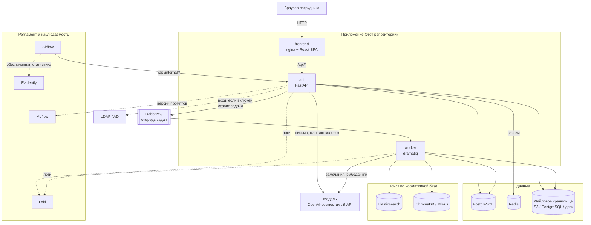
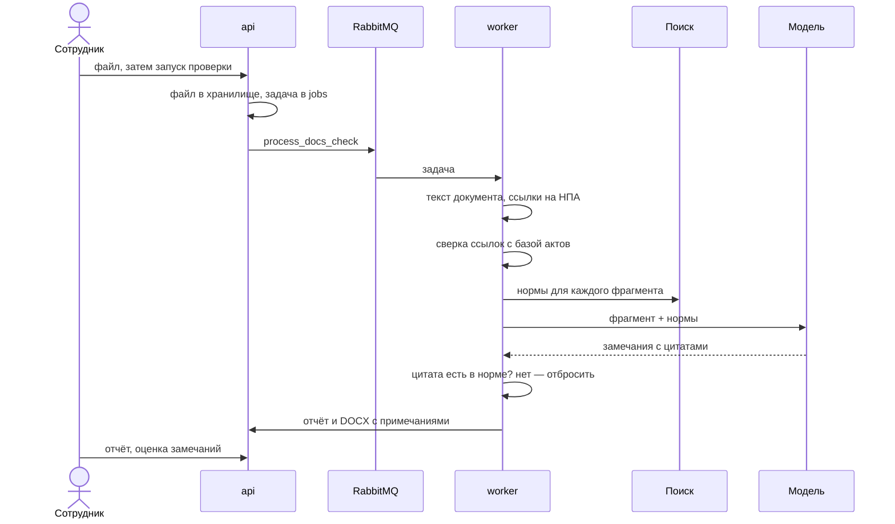
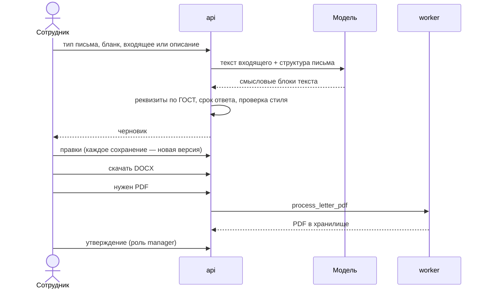
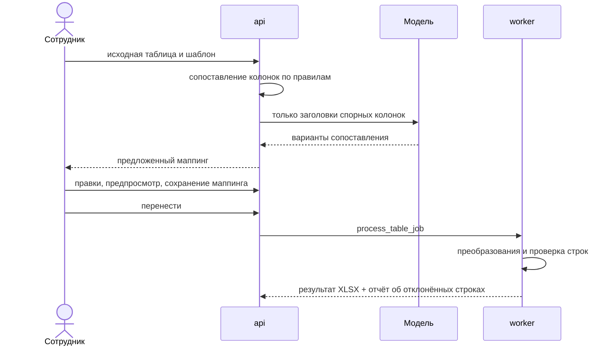
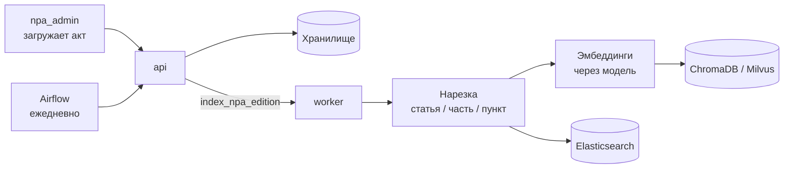
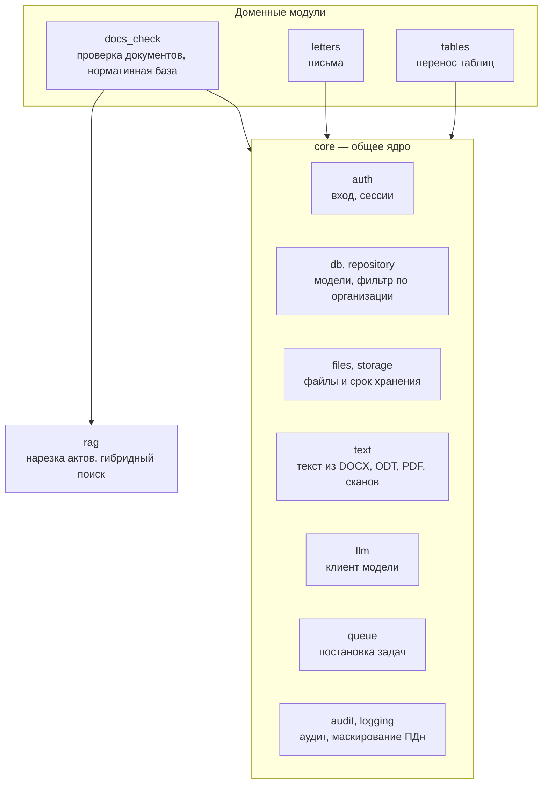

# Карта системы: что с чем работает и зачем

Короткая схема для знакомства с проектом. Здесь — кто с кем разговаривает и
зачем каждый компонент нужен. Обоснования решений и модель данных — в
[architecture.md](architecture.md) и [adr/](adr/README.md).

## 1. В двух словах

Приложение состоит из трёх своих процессов — `frontend`, `api`, `worker` — и
набора готовых сервисов вокруг них. Браузер видит только `frontend`. Быстрые
действия `api` выполняет сам, долгие (распознавание, индексация, PDF, перенос
таблиц) отдаёт воркеру через очередь. Наружу, за пределы контура организации,
не уходит ни один запрос.

## 2. Общая схема

Сплошная стрелка — обязательная связь, пунктирная — необязательная
(включается конфигурацией).

## 3. Компоненты: зачем каждый

### Свои процессы

| Компонент | Зачем нужен | С кем работает | Где лежит |
|---|---|---|---|
| `frontend` | Отдаёт интерфейс и проксирует `/api/*` в `api`. Единственная точка входа снаружи | браузер, `api` | `frontend/`, `deploy/docker/nginx.conf` |
| `api` | Вход и роли, приём файлов, быстрые операции, постановка долгих задач, аудит | PostgreSQL, Redis, хранилище, RabbitMQ, модель, LDAP | `backend/gosdoc/` |
| `worker` | Долгие операции: проверка документа, индексация НПА, PDF, перенос таблиц, очистка файлов | RabbitMQ, PostgreSQL, хранилище, поиск, модель | `workers/actors.py` + тот же код `backend/gosdoc/` |

`api` и `worker` — один и тот же код в разных образах: воркеру дополнительно
нужны LibreOffice (PDF) и Tesseract (распознавание сканов).

### Внешние сервисы

| Сервис | Зачем нужен | Кто обращается |
|---|---|---|
| PostgreSQL | Все данные: пользователи, задачи, письма, маппинги, нормативная база, отчёты, журнал аудита | `api`, `worker` |
| Redis | Сессии пользователей (токен из cookie → пользователь) | `api` |
| RabbitMQ | Очередь: `api` кладёт задачу, `worker` забирает | `api`, `worker` |
| Файловое хранилище | Загруженные и созданные файлы. Три варианта на выбор: S3 (SeaweedFS), PostgreSQL, локальный диск | `api`, `worker` |
| Elasticsearch | Поиск норм по словам (BM25) | `worker` |
| ChromaDB / Milvus | Поиск норм по смыслу (векторы) | `worker` |
| Модель | Черновик письма, подсказка по колонкам, замечания к документу, эмбеддинги | `api`, `worker` |
| LDAP / AD | Вход по учётной записи организации вместо локального пароля | `api` |
| Airflow | Расписание: дёргает служебные адреса `api` | → `api` |
| MLflow | Журнал версий промптов | `api` по команде Airflow |
| Evidently | Качество замечаний: сколько принято сотрудниками, сколько отброшено | Airflow |
| Loki | Сбор логов (`api` и `worker` пишут JSON в stdout) | агент сбора логов |

Два поиска дополняют друг друга: Elasticsearch находит точные формулировки и
номера, векторный — близкие по смыслу нормы. Результаты объединяются в
`rag/search.py`. Оба сервиса необязательны: без Elasticsearch по словам ищет
PostgreSQL, без векторной базы остаётся только поиск по словам (ADR-0011).

## 4. Что выполняется сразу, а что через очередь

| Действие | Где выполняется | Почему |
|---|---|---|
| Вход, списки, загрузка и скачивание файлов | `api` | быстро |
| Черновик письма, сборка DOCX | `api` (с вызовом модели) | пользователь ждёт результат на экране |
| Подсказка маппинга колонок, предпросмотр | `api` (с вызовом модели) | то же |
| Проверка документа | `worker` | распознавание, поиск и много обращений к модели |
| Индексация акта | `worker` | нарезка, эмбеддинги, запись в два индекса |
| PDF письма | `worker` | нужен LibreOffice |
| Перенос таблицы | `worker` | файлы могут быть большими, обрабатываются пачкой |
| Удаление файлов с истёкшим сроком | `worker` | по расписанию |

Очереди и задачи (`workers/actors.py`):

| Очередь | Задача | Кто ставит | Что делает |
|---|---|---|---|
| `docs_check` | `process_docs_check` | `POST /api/docs-check/jobs` | проверяет документ, сохраняет отчёт и DOCX с примечаниями |
| `npa` | `index_npa_edition` | загрузка акта, переиндексация, Airflow | режет акт на фрагменты и индексирует |
| `letters` | `process_letter_pdf` | `POST /api/letters/{id}/pdf` | превращает DOCX письма в PDF |
| `tables` | `process_table_job` | `POST /api/tables/jobs` | переносит данные, пишет результат и отчёт |
| `maintenance` | `cleanup_files` | Airflow | удаляет файлы старше срока хранения |

Задача ставится в очередь только после фиксации транзакции
(`core/queue.py`), иначе воркер не увидел бы запись о задаче в базе. Состояние
задачи хранится в таблице `jobs`, интерфейс опрашивает его через `api`.

## 5. Сценарии

### Проверка документа

Ссылки на акты проверяются без модели — сравнением с таблицами нормативной
базы. Модель участвует только в смысловой проверке, и её замечание
сохраняется лишь тогда, когда цитата дословно найдена в тексте нормы.

### Письмо

Модель пишет только текст. Реквизиты, оформление, срок ответа и маска
исходящего номера — обычный код (`letters/gost.py`, `letters/deadlines.py`).

### Перенос таблиц

Данные строк в модель не уходят. Каждая строка источника оказывается либо в
результате, либо в отчёте с причиной.

### Пополнение нормативной базы

## 6. Карта кода

### Экран → адрес API → логика

| Раздел | Экран | Адреса | Логика |
|---|---|---|---|
| Вход | `pages/LoginPage.tsx`, `ChangePasswordPage.tsx` | `/api/auth/*` | `api/auth.py`, `core/auth.py` |
| Проверка | `pages/docs/ChecksPage.tsx` | `/api/files`, `/api/docs-check/*` | `docs_check/` |
| Нормативная база | `pages/docs/NpaPage.tsx` | `/api/npa/*` | `docs_check/npa.py`, `rag/` |
| Письма | `pages/letters/LettersPage.tsx`, `LetterEditor.tsx` | `/api/letters/*`, `/api/letter-blanks` | `letters/` |
| Тест писем | `pages/letters/SandboxPage.tsx` | `/api/letters/sandbox` | `letters/` — пробная генерация без сохранения |
| Таблицы | `pages/tables/TablesPage.tsx` | `/api/files`, `/api/tables/*` | `tables/` |
| Пользователи | `pages/UsersPage.tsx` | `/api/admin/users` | `api/admin.py` |
| Организация | `pages/OrganizationPage.tsx` | `/api/admin/organization`, `/api/admin/holidays`, `/api/letter-blanks` | `api/admin.py`, `letters/` |
| Журнал действий | `pages/AuditPage.tsx` | `/api/admin/audit` | `api/admin.py`, `core/audit.py` |

Пути экранов — относительно `frontend/src/`, логики — относительно
`backend/gosdoc/`. Все запросы интерфейса идут через `frontend/src/api.ts`.

### Модули и ядро

Модули не зависят друг от друга — только от ядра. `rag` используется одним
модулем `docs_check` и сам от ядра не зависит: клиент модели и адреса
индексов ему передаёт `docs_check/npa.py`.

| Часть ядра | Что даёт модулям |
|---|---|
| `core/config.py` | все настройки из переменных окружения |
| `core/auth.py` | вход (локальный или LDAP), сессии в Redis, блокировка после неудачных попыток |
| `api/deps.py` | текущий пользователь и проверка ролей для адресов API |
| `core/db.py`, `core/repository.py` | общие таблицы и выборки только в пределах своей организации |
| `core/storage.py`, `core/files.py` | единый интерфейс хранилища, учёт файлов, удаление по сроку |
| `core/text.py` | извлечение текста из документов, распознавание сканов |
| `core/llm.py` | единственный клиент модели: `chat` и `embed` |
| `core/queue.py` | постановка задачи в очередь после фиксации транзакции |
| `core/audit.py`, `core/logging.py` | журнал действий, логи в JSON с маскированием персональных данных |
| `core/health.py` | проверка зависимостей для `/health/ready` и ожидания при старте |

### Роли

| Роль | Что открывает |
|---|---|
| `user` | проверки, письма, таблицы, просмотр нормативной базы |
| `manager` | утверждение писем |
| `npa_admin` | загрузка и правка нормативной базы, переиндексация |
| `sys_admin` | пользователи, организация, бланки, календарь, журнал действий; также права `npa_admin` |

## 7. Регламентные задачи

Airflow не содержит логики: каждый DAG вызывает служебный адрес `api` с
токеном `SERVICE_TOKEN` и записывает свой запуск в журнал аудита.

| DAG | Когда | Вызывает | Результат |
|---|---|---|---|
| `gosdoc_npa_update` | ежедневно, 02:00 | `POST /api/internal/npa/reindex` | доиндексация незавершённых редакций; по воскресеньям — полная |
| `gosdoc_maintenance` | ежедневно, 03:30 | `POST /api/internal/cleanup-files` | удаление файлов с истёкшим сроком |
| `gosdoc_quality` | ежедневно, 05:00 | `POST /api/internal/mlflow/sync-prompts`, `GET /api/internal/quality/findings` | версии промптов в MLflow, статистика замечаний в Evidently |

## 8. Локально и в эксплуатации

| Что | Локально (`make up-local`) | В эксплуатации (Kubernetes) |
|---|---|---|
| Запуск | `deploy/docker-compose.dev.yml` | Helm-чарт `deploy/helm/gosdoc` |
| Модель | заглушка `deploy/mock-llm` | сервис модели в контуре |
| Векторный поиск | ChromaDB | Milvus |
| Хранилище файлов | SeaweedFS | S3, PostgreSQL или диск — по настройке |
| Очистка файлов | контейнер `scheduler` | Airflow |
| Airflow, MLflow, Evidently, Loki | нет | подключаются |
| Базы и очередь | контейнеры | услуги платформы, адреса и пароли из конфигурации |

Порядок запуска одинаков: сначала `migrate` (ждёт зависимости, применяет
миграции, создаёт администратора), затем `api` и `worker`, последним —
`frontend`.

## 9. Куда смотреть дальше

| Вопрос | Документ |
|---|---|
| Почему так устроено, модель данных, безопасность | [architecture.md](architecture.md) |
| Отдельные решения и их последствия | [adr/](adr/README.md) |
| Установка, настройки, эксплуатация | [guides/admin.md](guides/admin.md) |
| Работа в интерфейсе | [guides/user.md](guides/user.md) |
| Правила разработки | [CONTRIBUTING.md](../CONTRIBUTING.md) |
